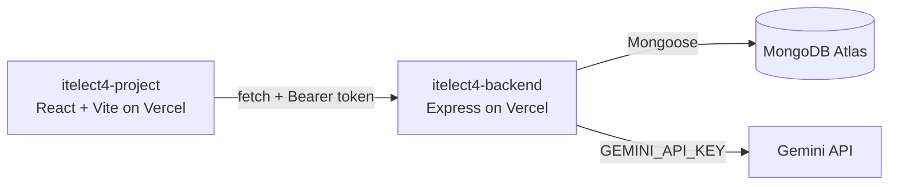

# ITELECT4 Submission Tracker

[](https://github.com/IanKarvey/itelect4-project/actions/workflows/ci.yml)

This project tracks student submissions for courses. It has students, courses, and submissions -- a student submits a repo URL for a course, which can later be scored.

## Live links

- Live frontend (website): https://itelect4-project-ian-karvey.vercel.app
- Live backend (API): https://itelect4-backend-ian-karvey.vercel.app/api/health
- Backend repo: https://github.com/IanKarvey/itelect4-backend

The site calls the live backend. Register an account, log in, and add a submission from the Submissions page. The AI Review page sends a project description to the backend and shows a checked review.

## Architecture



## Types Made

- `Student` - stores student info and enrolled course IDs
- `Instructor` - stores instructor info and role
- `Course` - stores course info, credits, instructor ID, and status
- `UserRole` - allowed roles: student, instructor, admin
- `CourseStatus` - enum for the course status
- `ApiResponse<T>` - generic response type
- `StudentUpdate` - uses `Partial<Student>` for updating student info
- `StudentPreview` - uses `Pick` to show only some student fields
- `PublicStudent` - uses `Omit` to hide the email
- `CourseStatusCount` - uses `Record` for counting course statuses

## GT2 Components

- `StudentCard` - shows student info and has typed click/change events
- `CourseCard` - shows course info using the `Course` type
- `StatusSummary` - shows course status counts using props and children

## How to Run

Copy `.env.example` to `.env` and set `VITE_API_URL` to the backend address (`http://localhost:4000` when the backend runs on your computer). It has no trailing slash and no `/api`. Restart `npm run dev` after changing it.

```bash
npm install
npm run dev
```

## Check for Errors

```bash
npm run build
npm test
```

GitHub Actions runs both on every push (see the CI badge at the top).

## AI use

I used Claude (Anthropic's AI assistant) as a coding assistant while building this project, alongside the course materials.
